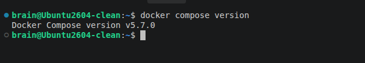

# Домашнее задание к занятию "`Docker. Часть 2`" - `Бекер Александр`


### Инструкция по выполнению домашнего задания

    Домашнее задание выполните в вашем git-репозиториий(предпочтительно) или Google Docs и отправьте на проверку ссылку на ваш документ в личном кабинете.
    В названии файла укажите номер лекции и фамилию студента. Пример названия: 6.4. Docker. Часть 2 — Александр Александров.
    Код решения размещайте в отдельном файле на вашем Google-диске, это облегчит проверку вашей работы.
    Перед отправкой проверьте, что доступ для просмотра открыт всем, у кого есть ссылка. Если нужно прикрепить дополнительные ссылки, добавьте их в свой Google Docs.

Вы можете прислать решение в виде ссылки на ваш репозийторий в GitHub, для этого воспользуйтесь шаблоном для домашнего задания.

Правила выполнения заданий к занятию «6.4. Docker. Часть 2»

    Все задания выполняйте на основе конфигов из лекции.
    В заданиях описаны те параметры, которые необходимо изменить.
    Если параметр не упомянут вообще, значит, его нужно оставить таким, какой он был в лекции.
    Если в каком-то задании, например, в задании 2, нужно изменить параметр, подразумевается, что во всех следующих заданиях будет использоваться уже изменённый параметр.
    Проверяйте правильность отступов. Очень важно их соблюдать, так как это влияет на структуру данных.
    Выполнив все задания без звёздочки, вы должны получить полнофункциональный сервис.

Любые вопросы по решению задач задавайте в разделе "Вопросы по заданию".
Дополнительные примеры

Примеры различных композ проектов от разработчиков Docker: https://github.com/docker/awesome-compose/blob/master/wireguard/compose.yaml
Дополнительная документация:

    блок networks: в compose
    блок volumes: в compose


---

### Задание 1

`Напишите ответ в свободной форме, не больше одного абзаца текста.`

_Установите Docker Compose и опишите, для чего он нужен и как может улучшить лично вашу жизнь._

1. `устанавливал по инструкции` [Install Docker Engine on Ubuntu](https://docs.docker.com/engine/install/ubuntu/)
2. `для чего он нужен? -` _для запуска и управления многоконтейнерными приложениями с помощью одного конфигурационного файла_
3. `как может улучшить лично вашу жизнь - ` _экономия времени, упрощает развертывание сервисов на новых локациях_


```bash
# установка пакета docker
$ sudo apt install docker-ce docker-ce-cli containerd.io docker-buildx-plugin docker-compose-plugin
```

`Cкриншоты`

`установка docker compose`




---

### Задание 2

`Выполните действия и приложите текст конфига на этом этапе.`

_Создайте файл docker-compose.yml и внесите туда первичные настройки:_
_version;_
_services;_
_volumes;_
_networks._
_При выполнении задания используйте подсеть 10.5.0.0/16. Ваша подсеть должна называться: <ваши фамилия и инициалы>-my-netology-hw. Все приложения из последующих заданий должны находиться в этой конфигурации._

```yaml
version: '3' 
services: 
volumes:
networks: 
  BekerAV-my-netology-hw: 
    driver: bridge 
    ipam: 
      config: 
        - subnet: 10.5.0.0/16 
          gateway: 10.5.0.1
```

---

### Задание 3

`Выполните действия:`

    Создайте конфигурацию docker-compose для Prometheus с именем контейнера <ваши фамилия и инициалы>-netology-prometheus.
    Добавьте необходимые тома с данными и конфигурацией (конфигурация лежит в репозитории в директории 6-04/prometheus ).
    Обеспечьте внешний доступ к порту 9090 c докер-сервера.

```yaml
version: '3' 
services: 
  BekerAV-netology-prometheus: 
     image: prom/prometheus:v2.47.2 
     container_name: BekerAV-netology-prometheus 
     command: --web.enable-lifecycle --config.file=/etc/prometheus/prometheus.yml 
     ports: 
       - 9090:9090 
     volumes: 
       - ./prometheus:/etc/prometheus 
       - prometheus-data:/prometheus 
     networks: 
        - BekerAV-my-netology-hw
     restart: always 

volumes: 
  prometheus-data:
networks: 
  BekerAV-my-netology-hw: 
    driver: bridge 
    ipam: 
      config: 
        - subnet: 10.5.0.0/16 
          gateway: 10.5.0.1
```


---


### Задание 4

`Выполните действия:`

    Создайте конфигурацию docker-compose для Pushgateway с именем контейнера <ваши фамилия и инициалы>-netology-pushgateway.
    Обеспечьте внешний доступ к порту 9091 c докер-сервера.

```yaml
version: '3' 
services: 
...
...
  BekerAV-netology-pushgateway: 
    image: prom/pushgateway:v1.6.2 
    container_name: BekerAV-netology-pushgateway 
    ports: 
      - 9091:9091 
    networks: 
      - BekerAV-my-netology-hw
    depends_on: 
      - BekerAV-netology-prometheus 
    restart: unless-stopped
...
...

```


---   


### Задание 5

`Выполните действия:`

    Создайте конфигурацию docker-compose для Grafana с именем контейнера <ваши фамилия и инициалы>-netology-grafana.
    Добавьте необходимые тома с данными и конфигурацией (конфигурация лежит в репозитории в директории 6-04/grafana.
    Добавьте переменную окружения с путем до файла с кастомными настройками (должен быть в томе), в самом файле пропишите логин=<ваши фамилия и инициалы> пароль=netology.
    Обеспечьте внешний доступ к порту 3000 c порта 80 докер-сервера.

```yaml
# файл ./docker-compose.yml
version: '3' 
services: 
  ...
  ...
  bekerav-netology-grafana: 
    image: grafana/grafana
    container_name: bekerav-netology-grafana
    environment: 
      GF_PATHS_CONFIG: /etc/grafana/custom.ini
    ports: 
      - 80:3000 
    volumes: 
      - ./grafana:/etc/grafana 
      - grafana-data:/var/lib/grafana
    networks: 
      - bekerav-my-netology-hw
    depends_on: 
      - bekerav-netology-prometheus  
    restart: unless-stopped 
volumes: 
  prometheus-data:
  grafana-data: 
networks: 
  bekerav-my-netology-hw: 
    driver: bridge 
    ipam: 
      config: 
        - subnet: 10.5.0.0/16 
          gateway: 10.5.0.1
```

```yaml
# файл  ./grafana/custom.ini
[security]

admin_user = bekerav
admin_password = netology
```

---


### Задание 6

`Выполните действия.`

    Настройте поочередность запуска контейнеров.
    Настройте режимы перезапуска для контейнеров.
    Настройте использование контейнерами одной сети.
    Запустите сценарий в detached режиме.


1. `Настройте поочередность запуска контейнеров -` 
      - определенно в **depends_on: - bekerav-netology-prometheus** (grafana и pushgateway запускаются после prometheus)
2. `Настройте режимы перезапуска для контейнеров -` 
      - определенно в **restart: unless-stopped; restart: always**
3. `Настройте использование контейнерами одной сети - `
      - определенно в сблоке **networks:** имя сети **bekerav-my-netology-hw:** 
4. `Запустите сценарий в detached режиме -` 
      ```bash 
      $ docker compose up -d 
      ```
```yaml
version: '3' 
services: 
  bekerav-netology-prometheus: 
     image: prom/prometheus:v2.47.2 
     container_name: bekerav-netology-prometheus 
     command: --web.enable-lifecycle --config.file=/etc/prometheus/prometheus.yml 
     ports: 
       - 9090:9090 
     volumes: 
       - ./prometheus:/etc/prometheus 
       - prometheus-data:/prometheus
     networks: 
        - bekerav-my-netology-hw
     restart: always 
  bekerav-netology-pushgateway:
    image: prom/pushgateway:v1.6.2
    container_name: bekerav-netology-pushgateway
    ports:
      - 9091:9091
    networks:
      - bekerav-my-netology-hw
    depends_on:
      - bekerav-netology-prometheus
    restart: unless-stopped
  bekerav-netology-grafana: 
    image: grafana/grafana
    container_name: bekerav-netology-grafana
    environment: 
      GF_PATHS_CONFIG: /etc/grafana/custom.ini
    ports: 
      - 80:3000 
    volumes: 
      - ./grafana:/etc/grafana 
      - grafana-data:/var/lib/grafana
    networks: 
      - bekerav-my-netology-hw
    depends_on: 
      - bekerav-netology-prometheus  
    restart: unless-stopped 
volumes: 
  prometheus-data:
  grafana-data: 
networks: 
  bekerav-my-netology-hw: 
    driver: bridge 
    ipam: 
      config: 
        - subnet: 10.5.0.0/16 
          gateway: 10.5.0.1

```
`Cкриншоты`

`запуск конфигурации`


---


### Задание 7

`Выполните действия.`

    Выполните запрос в Pushgateway для помещения метрики <ваши фамилия и инициалы> со значением 5 в Prometheus: echo "<ваши фамилия и инициалы> 5" | curl --data-binary @- http://localhost:9091/metrics/job/netology.
    Залогиньтесь в Grafana с помощью логина и пароля из предыдущего задания.
    Cоздайте Data Source Prometheus (Home -> Connections -> Data sources -> Add data source -> Prometheus -> указать "Prometheus server URL = http://prometheus:9090" -> Save & Test).
    Создайте график на основе добавленной в пункте 5 метрики (Build a dashboard -> Add visualization -> Prometheus -> Select metric -> Metric explorer -> <ваши фамилия и инициалы -> Apply.


`Cкриншоты`

`Выполните запрос в Pushgateway для помещения метрики`


`Залогиньтесь в Grafana`


`Cоздайте Data Source Prometheus`


`Создайте график `


---


### Задание 8

`Выполните действия:`

    Остановите и удалите все контейнеры одной командой.
    В качестве решения приложите скриншот консоли с проделанными действиями.


`Cкриншоты`

`Остановите и удалите все контейнеры одной командой`


---
